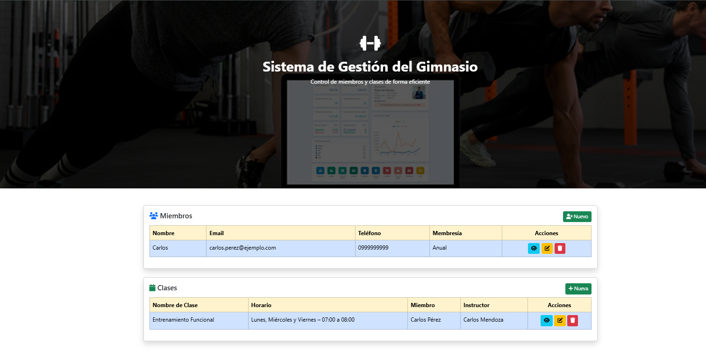

# Sistema de Gestión de Gimnasio

Aplicación web para administrar los miembros y las clases de un gimnasio, desarrollada con Django.

## Funcionalidades

- Página de inicio con el listado de miembros y clases
- Gestión de **miembros**: crear, ver detalle, editar y eliminar
- Gestión de **clases**: crear, ver detalle, editar y eliminar

## Tecnologías

- Python 3.13
- Django
- SQLite
- HTML y CSS

## Captura de pantalla



## Cómo ejecutarlo

```bash
git clone https://github.com/Velez-William/sistema-gestion-gimnasio.git
cd sistema-gestion-gimnasio/Gimnasio-django/gimnasio
python -m venv .venv
.venv\Scripts\activate
pip install django
python manage.py migrate
python manage.py runserver
```

Luego abre http://127.0.0.1:8000 en el navegador.

## Autor

William Vélez – Estudiante de Gestión de la Información Gerencial, Universidad de Guayaquil
